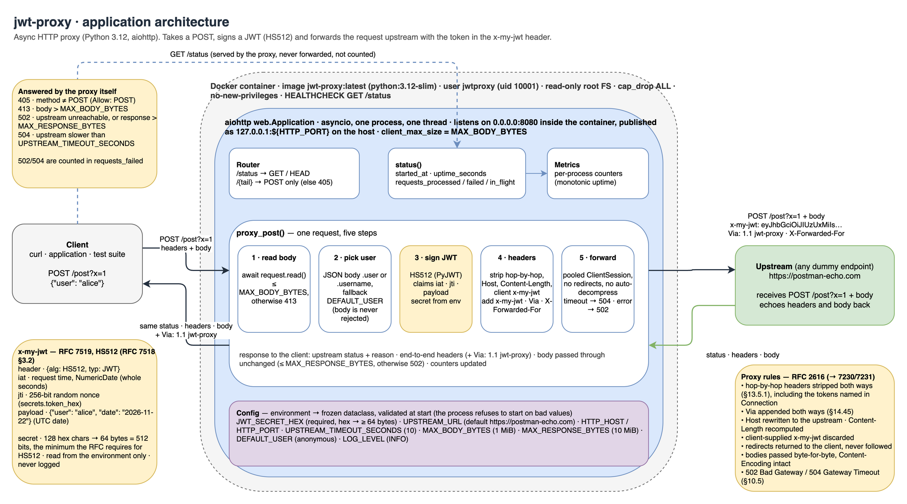
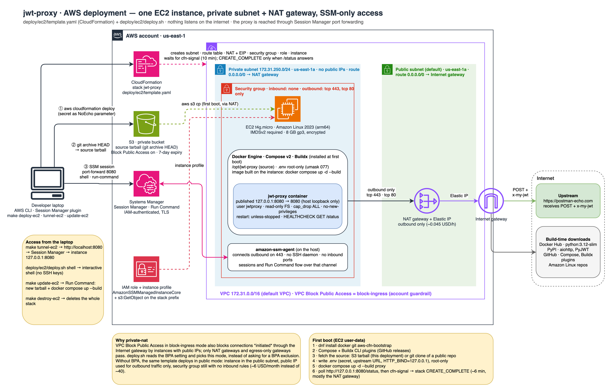

# Architecture and design

## 1. Purpose and scope

The Castlabs coding challenge asks for an HTTP proxy (in the sense of RFC 2616) that takes a `POST`
request, creates a JSON Web Token with three claims (`iat`, `jti`, `payload`), signs it with a given
hex secret using HS512, and forwards the request to an upstream endpoint with the token in the
`x-my-jwt` header. The brief also asks for Python 3.11+, Docker 27/28 with a Compose Specification
file, a `Makefile` with `build` and `run` targets (`HTTP_PORT` selects the port), a public GitHub
repository with a README, and, as bonus points, a `/status` page, asynchronous programming, tests
and a `make test` target.

This document explains how **jwt-proxy** meets that brief: the request flow, the code structure,
the design decisions and their rationale, the container packaging, and the infrastructure used to
run it on AWS. The usage guide (document 02) covers day-to-day operation; document 03 covers the AWS
deployment that was stood up for the review; document 04 is the solution-design part of the
challenge.

Everything described here is implemented and exercised by the test suite (45 tests) and by a real
deployment; nothing is aspirational unless explicitly marked as "production shape" or "left out".

## 2. The big picture

The proxy is a single asynchronous process built on **aiohttp**. A client sends a `POST` to any path;
the proxy reads the body, derives the username, mints a fresh HS512-signed JWT, rewrites the headers
according to the proxy rules of RFC 2616, forwards the request to `UPSTREAM_URL` + the original path
and query string, and returns the upstream response unchanged (status, headers and body). The
default upstream is `https://postman-echo.com`, which echoes what it received so the injected header
is visible in the response. `GET /status` is answered by the proxy itself. Figure 1 shows the whole picture.

<figure class="landscape-figure">

<figcaption>Figure 1 — Application architecture. Source: <code>docs/architecture.drawio</code>, page 1.</figcaption>
</figure>

## 3. Request flow

| step | what happens | where |
|------|--------------|-------|
| 1 | The body is read in full, bounded by `MAX_BODY_BYTES` (default 1 MiB). Larger bodies get `413`. | `proxy.py` / aiohttp `client_max_size` |
| 2 | The username is taken from a JSON object body (`user`, then `username`); anything else falls back to `DEFAULT_USER`. The body is never rejected because of this. | `signing.extract_user()` |
| 3 | Claims are built (`iat`, `jti`, `payload`) and signed with HS512 using the hex-decoded secret. | `signing.create_token()` |
| 4 | Headers are rewritten: hop-by-hop headers, `Host`, `Content-Length` and any client-supplied `x-my-jwt` are removed; `x-my-jwt`, `Via` and `X-Forwarded-For` are added. | `proxy.end_to_end_headers()`, `append_via()`, `append_forwarded_for()` |
| 5 | The request is sent upstream through one pooled `ClientSession` (no redirects followed, no automatic decompression, total timeout `UPSTREAM_TIMEOUT_SECONDS`). | `proxy.proxy_post()` |
| 6 | The upstream status, reason, end-to-end headers (+ `Via`) and body are returned to the client. The body is capped by `MAX_RESPONSE_BYTES`. Counters are updated. | `proxy.proxy_post()` |

Failure paths are mapped to the status codes RFC 2616 §10.5 reserves for gateways:

| situation | response | counted in |
|-----------|----------|------------|
| method other than `POST` on a proxied path | `405 Method Not Allowed`, `Allow: POST` | not counted (never reaches the proxy handler) |
| request body larger than `MAX_BODY_BYTES` | `413 Request Entity Too Large` | not counted |
| upstream unreachable, connection reset, TLS error | `502 Bad Gateway` | `requests_processed` and `requests_failed` |
| upstream response larger than `MAX_RESPONSE_BYTES` | `502 Bad Gateway` | `requests_processed` and `requests_failed` |
| upstream slower than `UPSTREAM_TIMEOUT_SECONDS` | `504 Gateway Timeout` | `requests_processed` and `requests_failed` |
| upstream answers with an error status (4xx/5xx) or a redirect | passed through unchanged | `requests_processed` only |

## 4. Code structure

```
src/jwt_proxy/
├── config.py    environment → immutable Config, validated at startup (fail fast)
├── signing.py   claims + HS512 signing (PyJWT), username extraction
├── proxy.py     handlers: POST proxy, /status; header rules; metrics
├── app.py       aiohttp Application factory, pooled client session, main()
└── __main__.py  python -m jwt_proxy
```

Four small modules with one job each. `signing.py` and `config.py` are plain functions and
dataclasses, so they are unit-tested without a server; `proxy.py` is tested end to end through
aiohttp's in-process test client against a fake upstream that records what it receives and offers
misbehaving endpoints (slow, oversized, redirecting, failing, compressed).

Runtime dependencies are exactly two: `aiohttp` (server, client and test utilities) and `PyJWT`
(RFC 7519 encoding and HS512 signing). Test dependencies are `pytest` and `pytest-aiohttp`.

## 5. Design decisions

### 5.1 aiohttp for both server and client

A proxy is mostly about moving bytes and headers faithfully. aiohttp gives, in one well-maintained
dependency, an asyncio HTTP/1.1 server with direct access to raw headers and body, an asyncio HTTP
client with connection pooling, and test utilities (`aiohttp_client`, `aiohttp_server`) for
in-process end-to-end tests. A web framework (FastAPI/Flask) adds routing and validation that a proxy
does not need and would still require an HTTP client library; raw `asyncio` sockets would mean
writing an HTTP parser.

### 5.2 Asynchronous by design

A proxy spends almost all of its time waiting on the network. With asyncio a single process handles
thousands of concurrent in-flight requests with one thread and a few MB of memory; a
thread-per-request design would need a pool sized for the peak and would still block on each upstream
call. One `ClientSession` is created when the application starts (`cleanup_ctx`) and closed when it
stops, so upstream connections are pooled across requests.

### 5.3 Reverse-proxy semantics

The challenge says "append the JWT to the upstream POST request", which describes a reverse proxy
with a fixed upstream rather than a forward proxy that receives absolute URIs. The incoming path and
query string are appended to `UPSTREAM_URL` untouched (`POST /post?x=1` → `UPSTREAM_URL/post?x=1`),
which is how a proxy sits in front of a real service. Only `POST` is proxied; other methods receive
`405` with an `Allow: POST` header, so the behaviour is explicit rather than silently permissive.

### 5.4 The JWT

| claim | value | rationale |
|-------|-------|-----------|
| `iat` | `int(time.time())` when the request is handled | RFC 7519 §4.1.6: a NumericDate in whole seconds |
| `jti` | `secrets.token_hex(32)`, 256 bits from the OS CSPRNG | unique per request without coordination between instances, which keeps the proxy stateless |
| `payload` | `{"user": <username>, "date": <UTC date, YYYY-MM-DD>}` | the nested object exactly as the statement writes it; ISO 8601 date |

The challenge gives a 128-character hex string. Decoded, that is exactly 64 bytes = 512 bits, the
hash output size of HMAC-SHA-512 and the minimum key length RFC 7518 §3.2 requires for HS512 ("MUST
be used with a key at least as long as the hash output"). That is strong evidence the string is meant
to be hex-decoded rather than used as ASCII, so the proxy does `bytes.fromhex()` and refuses to
start with keys shorter than 64 bytes. The token header is `{"alg": "HS512", "typ": "JWT"}`; a
verifier should pin `algorithms=["HS512"]` and never accept `none` or whatever the header claims.

### 5.5 Proxy correctness against RFC 2616 and its successors

| rule | implementation |
|------|----------------|
| hop-by-hop headers are not forwarded (§13.5.1), including any header named in `Connection` (§14.10) | `end_to_end_headers()` applied in both directions |
| a proxy appends itself to `Via` (§14.45) | `append_via()` in both directions (`Via: 1.1 jwt-proxy`) |
| `Host` reflects the upstream (§14.23) | dropped; the client library sets it from the upstream URL |
| `Content-Length` matches the forwarded body (§14.13) | dropped and recomputed by aiohttp |
| `502` for upstream failure, `504` for upstream timeout (§10.5) | exception mapping in `proxy_post()` |
| redirects are returned to the client, not followed by the proxy | `allow_redirects=False` |
| bodies are passed byte-for-byte, `Content-Encoding` intact | `auto_decompress=False` on the client session |
| no headers invented by the client library (`Accept`, `User-Agent`, ...) | `skip_auto_headers` |
| the client cannot smuggle its own token | client-supplied `x-my-jwt` removed before signing |
| the client address is preserved for the upstream | `X-Forwarded-For` appended (de-facto standard, later RFC 7239) |

### 5.6 Where the username comes from

The request is the only context the proxy has in this exercise, so `payload.user` is read from the
request body. In production, the value signed into a token must come from a verified identity (mTLS
client certificate, API key, upstream authentication session) and the proxy itself would sit behind
the organisation's ingress authentication; signing attacker-controlled input would make the token
worthless as an assertion. This is deliberately called out in the README as an assumption.

## 6. Security considerations

* **Secret handling.** The signing secret is read from the environment (`JWT_SECRET_HEX`), never
  from code; the challenge value lives only in `.env.example`, and `.env` is git-ignored. The process
  refuses to start without a valid key. Neither the token nor the body is ever logged: the access log
  carries method, path, status, size, referer and user agent only.
* **Bounded resources.** Request and response bodies are capped (`413` / `502`), and every upstream
  call has a total timeout (`504`), so a slow or hostile peer cannot exhaust memory or hang
  connections indefinitely.
* **Private by default.** Without Docker the proxy binds to `127.0.0.1`. With Compose the container
  port is published on `127.0.0.1` of the host; exposing it on every interface is one explicit
  variable (`HTTP_BIND=0.0.0.0`). In the AWS deployment nothing listens on the internet at all.
* **Hardened container.** Non-root user (`jwtproxy`, uid 10001), read-only root filesystem, `/tmp`
  on tmpfs, all Linux capabilities dropped, `no-new-privileges`, a `HEALTHCHECK` on `/status`.
* **Fail fast on configuration.** Invalid secret (missing, non-hex, too short), a relative or
  non-HTTP upstream URL, non-positive ports or timeouts stop the process with a clear message
  instead of running misconfigured.

## 7. Packaging

### 7.1 Container image

The `Dockerfile` has three stages on top of `python:3.12-slim`:

```
python:3.12-slim ──▶ base     pip install .            (application + runtime dependencies)
                      ├──▶ test     + pytest, pytest-aiohttp, tests/   → make test
                      └──▶ runtime  non-root user, HEALTHCHECK, CMD   → make run
```

Test dependencies and test code never reach the runtime image. Inside the image the proxy listens on
`0.0.0.0:8080`, which is required for the published port to reach it; exposure is governed by the
port mapping in Compose, not by the in-container bind.

### 7.2 Compose

`docker-compose.yml` follows the Compose Specification (no top-level `version` key) and defines two
services:

* `proxy` — the runtime image; environment from `.env` (`JWT_SECRET_HEX` is required through
  `${VAR:?}` so a missing secret fails immediately); `ports: "${HTTP_BIND:-127.0.0.1}:${HTTP_PORT:-8080}:8080"`;
  `restart: unless-stopped`; `read_only`, `tmpfs: /tmp`, `cap_drop: ALL`, `no-new-privileges`.
* `tests` — the test stage, behind the `test` profile so `docker compose up` never starts it;
  `make test` runs it once (`docker compose --profile test run --build --rm tests`) and removes the
  container.

### 7.3 Configuration and secrets

Twelve-factor: every setting is an environment variable with a safe default except the secret.
Locally the secret lives in a git-ignored `.env` that `make run` creates from `.env.example` on
first use. In a real deployment it would be injected by the platform (Docker/Swarm secrets, a
Kubernetes `Secret`, AWS Secrets Manager or SSM Parameter Store into the task definition) and
rotated by publishing a new value and rolling the instances.

| variable | default | meaning |
|----------|---------|---------|
| `JWT_SECRET_HEX` | *(required)* | HS512 secret, hex encoded; must decode to at least 64 bytes |
| `UPSTREAM_URL` | `https://postman-echo.com` | base URL; incoming path and query are appended |
| `HTTP_PORT` | `8080` | listening port (host port when running with Compose) |
| `HTTP_BIND` | `127.0.0.1` | Compose only: host interface to publish on |
| `HTTP_HOST` | `127.0.0.1` | bind address without Docker (`0.0.0.0` inside the image) |
| `UPSTREAM_TIMEOUT_SECONDS` | `10` | total timeout for the upstream call → `504` |
| `MAX_BODY_BYTES` | `1048576` | largest accepted request body → `413` |
| `MAX_RESPONSE_BYTES` | `10485760` | largest accepted upstream response → `502` |
| `DEFAULT_USER` | `anonymous` | `payload.user` when the body has no `user`/`username` |
| `LOG_LEVEL` | `INFO` | Python log level |

## 8. Infrastructure: the AWS deployment

The proxy was deployed to a single EC2 instance with CloudFormation (`deploy/ec2/template.yaml`,
driven by `deploy/ec2/deploy.sh` and the `make deploy-ec2` family of targets). The goal was the
smallest deployment that runs the exact artifact a reviewer runs locally, with nothing listening on
the internet. Figure 2 shows the resulting topology.

<figure class="landscape-figure">

<figcaption>Figure 2 — AWS deployment in private-nat mode. Source: <code>docs/architecture.drawio</code>, page 2.</figcaption>
</figure>

### 8.1 Resources created by the stack

| resource | purpose |
|----------|---------|
| IAM role + instance profile | `AmazonSSMManagedInstanceCore` so Systems Manager can reach the instance; in S3 source mode, `s3:GetObject` on the stack's own prefix of the source bucket. Nothing else. |
| Security group | **No inbound rules.** Outbound TCP 443 and 80 only (SSM, S3, Docker Hub, GitHub, PyPI, Amazon Linux mirrors, the upstream). |
| EC2 instance | Graviton `t4g.micro`, latest Amazon Linux 2023 arm64 AMI resolved from the public SSM parameter, IMDSv2 required, 8 GB encrypted gp3 root volume, `CreationPolicy` waiting for a `cfn-signal`. |
| private-nat mode only | A private subnet in the same AZ as the chosen public subnet, a route table whose default route is a NAT gateway with an Elastic IP in the public subnet. The instance has no public IP. |

### 8.2 Network modes

`deploy.sh` reads the account's **VPC Block Public Access** (BPA) setting and picks the mode
(`NETWORK_MODE=public|private-nat` overrides it):

* **public** (BPA off): the instance sits in the public subnet with a public IP that is used for
  outbound traffic only; the security group still has no inbound rules. About USD 6–7 per month.
* **private-nat** (BPA `block-ingress` or `block-bidirectional`): BPA also stops instances with
  public IPs from *initiating* connections through an internet gateway and only lets NAT gateways
  and egress-only gateways through. The instance goes into a private subnet without a public IP and
  reaches the internet through a NAT gateway. This respects the account guardrail instead of asking
  for a BPA exclusion. The NAT gateway adds about USD 0.045 per hour plus USD 0.045 per GB, so
  roughly USD 40 per month in total.

The review deployment runs in private-nat mode because the target account has BPA enabled.

### 8.3 How the code reaches the instance

With a public git remote, the first-boot script clones `REPO_URL` at `GIT_REF`. Without one (or when
the remote does not yet have the ref), `deploy.sh` uploads `git archive HEAD` as a tarball to a
private bucket of the account (`jwt-proxy-src-<account>-<region>`, all four S3 Block Public Access
settings on, objects expire after 7 days) and the instance role may read only that stack's prefix.
Uncommitted changes are never deployed.

### 8.4 First boot

The EC2 user-data script installs Docker, the Compose and Buildx CLI plugins (Amazon Linux 2023
ships only the engine, and Compose needs Buildx to build images) and the CloudFormation helper;
fetches the code; writes a root-only `.env` (`umask 077`, kept out of the shell trace); runs
`docker compose up -d --build proxy`; polls `http://127.0.0.1:8080/status`; and only then signals
CloudFormation. The stack reaches `CREATE_COMPLETE` only when the proxy is actually serving (about
six minutes in private-nat mode, most of it the NAT gateway). On failure the stack is deployed with
`--disable-rollback`, so the instance stays available for inspection over SSM.

### 8.5 Access model

The container publishes `127.0.0.1:8080` on the instance and the security group has no inbound
rules. Access goes through **SSM Session Manager**, authenticated by the operator's AWS credentials
and carried over the agent's outbound TLS connection: `make tunnel-ec2` forwards
`http://localhost:8080` to the instance, `deploy/ec2/deploy.sh shell` opens an interactive shell
without SSH keys or open ports, and `make update-ec2` ships a new commit through Run Command.
Opening the port to a single address is possible in public mode (`ALLOWED_CIDR=x.x.x.x/32`; the
template rejects anything wider than `/24`, so `0.0.0.0/0` is impossible), but was not used.

## 9. Running at scale

The proxy is **stateless**: no sessions, no shared storage, and the nonce needs no coordination.
Scaling is therefore horizontal:

```
Clients ──▶ Load balancer / ingress (TLS termination, caller authentication)
               ├──▶ jwt-proxy #1 ─┐
               ├──▶ jwt-proxy #2 ─┼──▶ Upstream API
               └──▶ jwt-proxy #n ─┘
                     └── /status, logs ──▶ monitoring
```

* Run N replicas behind a load balancer (an ECS/Fargate service, a Kubernetes `Deployment` with an
  HPA on CPU or requests per second, or `docker compose up --scale` once the host port mapping is
  removed).
* TLS terminates at the load balancer; the proxy speaks plain HTTP inside the private network. Caller
  authentication also belongs at that layer.
* Each process is single-threaded asyncio; on a multi-core host run one container per core rather
  than threads.
* `/status` counters are per instance by design. If aggregate numbers are needed, expose a
  Prometheus `/metrics` endpoint (a 20-line addition with `prometheus_client`) and let the scraper
  aggregate.
* Liveness and readiness probes point at `/status`; the Docker `HEALTHCHECK` already encodes it.
  Logs go to stdout for the platform's collector.

### Deliberately left out

Kept out to stay within the four-hour brief; each is a contained change:

* streaming of large upstream responses (today buffered and capped);
* retries with backoff for upstream failures (`POST` is not idempotent, so retries need an
  idempotency key from the caller);
* a `kid` header and multi-key support for secret rotation without downtime;
* rate limiting and caller authentication (belong at the ingress);
* HTTPS on the proxy itself (belongs at the load balancer);
* for the AWS deployment: redundancy, TLS and an ALB (it is a demo environment, not a production design).

## 10. Quality: tests and CI

45 tests (`pytest` + `pytest-aiohttp`) cover token signing and claims, username extraction,
configuration validation, and the proxy end to end against a fake upstream:

| area | what is asserted |
|------|------------------|
| signing | HS512 header, signature verifies with the hex-decoded secret and fails with another key or algorithm; `iat` is a whole-second NumericDate; `payload` shape and UTC date; 1000 `jti` values are unique |
| user extraction | `user` / `username` / whitespace / wrong types / non-JSON / invalid UTF-8 / empty body |
| configuration | defaults, overrides, trailing slash removal, every rejection path (missing or short secret, non-hex, relative URL, bad port or timeout) |
| proxy | method, path, query, body and headers reach the upstream; a fresh token per request; a forged `x-my-jwt` is replaced; hop-by-hop stripping both ways; `Via` and `X-Forwarded-For` added and extended; `503` and `302` pass through; gzip bodies pass through intact; `405`, `413`, `502` (unreachable, oversized) and `504` |
| status | uptime and counters, failures counted, `/status` itself never proxied or counted, `405` for `POST /status` |

GitHub Actions (`.github/workflows/ci.yml`) runs `make test`, `make build` and a smoke test of the
running container (status page, a real `POST` through postman-echo, counter incremented) on every
push, plus the suite on Python 3.11, 3.12 and 3.13 without Docker.

## Appendix A — Repository map

| path | contents |
|------|----------|
| `src/jwt_proxy/` | the application (four modules) |
| `tests/` | the test suite and the fake upstream fixture |
| `Dockerfile`, `docker-compose.yml`, `Makefile`, `.env.example` | packaging and developer entry points |
| `deploy/ec2/` | CloudFormation template and deployment script |
| `docs/design.md`, `docs/deploy-ec2.md` | design and deployment notes (Markdown) |
| `docs/drmtoday-solution-design.md` | the solution-design part of the challenge |
| `docs/architecture.drawio`, `docs/img/` | editable diagrams and their rendered PNGs |
| `docs/deliverables/` | sources and build script for these PDF documents |
| `.github/workflows/ci.yml` | continuous integration |

## Appendix B — References

* RFC 2616, *Hypertext Transfer Protocol — HTTP/1.1* (§10.5 gateway status codes, §13.5.1 hop-by-hop headers, §14.10 `Connection`, §14.45 `Via`); superseded by RFC 7230–7235.
* RFC 7519, *JSON Web Token (JWT)* (§4.1.6 `iat`, §4.1.7 `jti`).
* RFC 7518, *JSON Web Algorithms (JWA)* §3.2, HMAC with SHA-2 key length requirement.
* Compose Specification, <https://compose-spec.io>.
* AWS VPC Block Public Access, <https://docs.aws.amazon.com/vpc/latest/userguide/security-vpc-bpa.html>.
