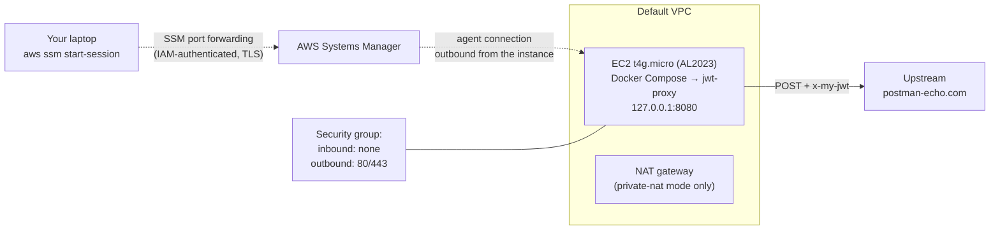

# Deploying to a single EC2 instance

`deploy/ec2/` puts the proxy on one Amazon Linux 2023 instance running the
same `docker compose` setup as on a laptop. One CloudFormation template, one
shell script, no inbound network access.



## What the stack creates

| resource | purpose |
|----------|---------|
| IAM role + instance profile | `AmazonSSMManagedInstanceCore` only: lets Systems Manager reach the instance. In S3 source mode, additionally `s3:GetObject` on the stack's own prefix of the source bucket. Nothing else. |
| Security group | **No inbound rules.** Outbound TCP 80/443 only (SSM, GitHub, Docker Hub, PyPI, the upstream). With `ALLOWED_CIDR` set (public mode only), one inbound rule for `HTTP_PORT` from that CIDR. |
| EC2 instance | Graviton `t4g.micro` by default, latest AL2023 arm64 AMI resolved from the public SSM parameter, IMDSv2 required, 8 GB encrypted gp3 root volume. |
| private-nat mode only | A private subnet (`172.31.25x.0/24`, same AZ as the public subnet), a route table whose default route is a NAT gateway with an Elastic IP placed in the public subnet. The instance has **no public IP**. |

### Network modes

`deploy.sh` picks the mode from the account's
[VPC Block Public Access](https://docs.aws.amazon.com/vpc/latest/userguide/security-vpc-bpa.html)
setting (`NETWORK_MODE=public|private-nat` overrides it):

* **public** (BPA off): the instance sits in the public subnet with a public
  IP that is used for outbound traffic only; the security group has no inbound
  rules. Cheapest: about USD 6–7 per month.
* **private-nat** (BPA `block-ingress` or `block-bidirectional`): BPA also
  stops instances with public IPs from *initiating* connections through an
  internet gateway and only allows NAT gateways. The instance goes into a
  private subnet without a public IP and reaches the internet through a NAT
  gateway. This is the textbook private-instance layout and respects the
  account guardrail instead of adding a BPA exclusion. Cost: the NAT gateway
  adds about USD 0.045 per hour (≈ 33 USD/month) plus 0.045 USD per GB
  processed, so roughly USD 40 per month in total. `ALLOWED_CIDR` is not
  available in this mode (nothing to open).

### Source of the code

The instance needs the repository. With a git `origin` remote the first-boot
script clones `REPO_URL` at `GIT_REF`. Without one (the checkout has not been
pushed yet) `deploy.sh` uploads `git archive HEAD` as a tarball to a private
bucket of the account (`jwt-proxy-src-<account>-<region>`, all four Block
Public Access settings on, objects expire after 7 days) and the instance role
may read only that stack's prefix.

First boot (`UserData`): install Docker, the Compose and Buildx CLI plugins
(AL2023 ships only the engine; Compose needs Buildx to build images) and the
CloudFormation helper; fetch the code; write a root-only `.env` with the
secret; `docker compose up -d --build proxy`; wait until `/status` answers;
signal CloudFormation. The stack only reaches `CREATE_COMPLETE` once the proxy
is serving (about 6 minutes in private-nat mode, most of it the NAT gateway).

`make destroy-ec2` removes everything the stack created (the source bucket
stays; its objects expire by themselves).

## Access model

Default: **private**. The container publishes `127.0.0.1:8080` on the
instance, the security group has no inbound rules, and you reach it through
SSM Session Manager port forwarding, which is authenticated by your AWS
credentials and needs no SSH key, bastion or open port:

```bash
make tunnel-ec2                  # keeps running; in another terminal:
curl -s http://localhost:8080/status
curl -s -X POST http://localhost:8080/post -H 'content-type: application/json' -d '{"user": "alice"}'
```

Optional: **one allowed address**. `ALLOWED_CIDR=203.0.113.7/32 make deploy-ec2`
publishes the port on the instance's public IP and opens the security group
to that CIDR only (the template rejects anything wider than `/24`, so
`0.0.0.0/0` is impossible). Anyone at that address can then use the proxy
without authentication; deciding who may call it belongs in front of the
proxy (ALB + authentication, or an API gateway), not inside it.

## Prerequisites

* AWS CLI v2 with credentials for the target account (`AWS_PROFILE`,
  `AWS_REGION` or `aws configure`). Creating the stack needs rights on
  CloudFormation, EC2, IAM (role + instance profile) and SSM parameter reads.
* Either the repository pushed to a **public** GitHub URL (the instance clones
  it; private repositories would need a deploy key or token on the instance),
  or no remote at all, in which case the committed tree is shipped through a
  private S3 bucket (see above). Uncommitted changes are never deployed.
* For `tunnel`/`shell`: the Session Manager plugin
  (`brew install --cask session-manager-plugin` on macOS).

## Commands

```bash
make deploy-ec2                                  # create or update the stack, print outputs
HTTP_PORT=9090 make deploy-ec2                   # proxy on port 9090 on the instance
STACK_NAME=jwt-proxy-demo GIT_REF=v1.0.0 make deploy-ec2
make status-ec2                                  # stack status + outputs (instance id, commands)
make tunnel-ec2                                  # http://localhost:8080 -> instance
make update-ec2                                  # git pull + docker compose up --build on the instance
make destroy-ec2                                 # delete everything
deploy/ec2/deploy.sh shell                       # interactive shell over SSM
```

Defaults the script derives for you: `REPO_URL` from the `origin` remote,
`GIT_REF` from the current branch, `JWT_SECRET_HEX` from `./.env`, VPC and
subnet from the account's default VPC, `NETWORK_MODE` from the BPA setting,
`PRIVATE_SUBNET_CIDR` as the first free `/24` in `172.31.250-255` (set it
yourself for a VPC that is not `172.31.0.0/16`). Every one can be overridden
with the environment variable of the same name.

## Updating

* **New commits**: `make update-ec2` ships the new code (`git pull`, or a new
  tarball in S3 mode) and runs `docker compose up -d --build` on the instance
  through SSM Run Command, then prints the output. Downtime is the container
  restart (a second or two).
* **Different branch, secret or upstream**: these live in the first-boot
  script, so they are applied by recreating the instance:
  `make destroy-ec2 && GIT_REF=... make deploy-ec2`. For a quick manual
  change, `deploy/ec2/deploy.sh shell`, edit `/opt/jwt-proxy/.env`, then
  `docker compose up -d`.

## Troubleshooting

* Stack stuck in `CREATE_IN_PROGRESS` then `CREATE_FAILED`: the proxy did
  not answer within 10 minutes. The script deploys with `--disable-rollback`,
  so the instance is still there: `deploy/ec2/deploy.sh shell`, then
  `sudo cat /var/log/cloud-init-output.log` and
  `sudo docker compose -f /opt/jwt-proxy/docker-compose.yml logs`.
  Delete the stack before deploying again.
* `TargetNotConnected` from SSM: the agent needs a minute after boot, and
  outbound 443 must be allowed (it is, unless the subnet has no route to an
  internet gateway; pick a public subnet with `SUBNET_ID`).
* `no default VPC found`: pass `VPC_ID` and a public `SUBNET_ID`.

## Why this shape, and what production would add

One instance with Compose is the smallest deployment that runs the exact
artifact the reviewer runs locally, with nothing listening on the internet.
It is a demo environment, not a production design: it has no redundancy and
no TLS. The production shape is in [`design.md`](design.md#scaling-and-running-in-production):
several replicas (ECS/Fargate or EKS) behind an Application Load Balancer that
terminates TLS and authenticates callers, the secret in Secrets Manager, and
metrics scraped from the instances.
