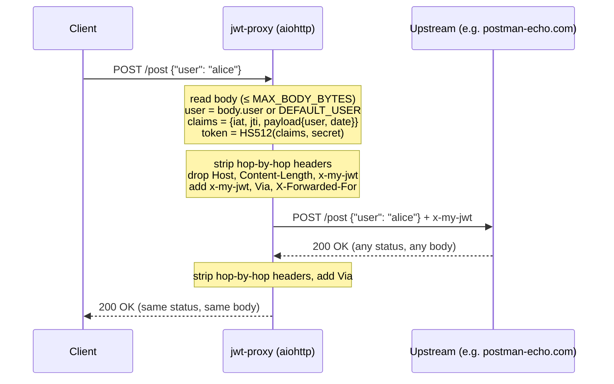
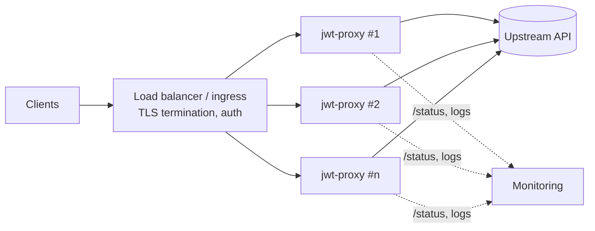

# Design notes: jwt-proxy

This document explains how the proxy is built, why it is built that way, and
how it is packaged and would be operated. The README covers usage.

## 1. What the proxy does



Failure paths: upstream unreachable → `502`, upstream slower than
`UPSTREAM_TIMEOUT_SECONDS` → `504`, upstream body over `MAX_RESPONSE_BYTES`
→ `502`, request body over `MAX_BODY_BYTES` → `413`, method other than
`POST` → `405`.

## 2. Code structure

```
src/jwt_proxy/
├── config.py    environment → immutable Config, validated at startup (fail fast)
├── signing.py   claims + HS512 signing (PyJWT), username extraction
├── proxy.py     handlers: POST proxy, /status; header rules; metrics
├── app.py       aiohttp Application factory, pooled client session, main()
└── __main__.py  python -m jwt_proxy
```

Four small modules with one job each. `signing.py` and `config.py` are plain
functions and dataclasses, so they are unit-tested without a server;
`proxy.py` is tested end to end through aiohttp's test client against a fake
upstream (`tests/conftest.py`).

### Why aiohttp

The task is an HTTP proxy, which is mostly about moving bytes and headers
faithfully. aiohttp gives, in one well-maintained dependency:

* an asyncio HTTP/1.1 server with direct access to raw headers and body,
* an asyncio HTTP client with connection pooling (one `ClientSession` shared
  for the lifetime of the process, created in `cleanup_ctx`),
* test utilities (`aiohttp_client`, `aiohttp_server`) for in-process
  end-to-end tests with no sockets to manage by hand.

A web framework (FastAPI/Flask) adds routing and validation we do not need and
would still require an HTTP client library. Raw `asyncio` sockets would mean
writing an HTTP parser.

### Why asynchronous

A proxy spends almost all of its time waiting on the network. With asyncio a
single process handles thousands of concurrent in-flight requests with one
thread and a few MB of memory; a thread-per-request design would need a thread
pool sized for the peak and would still block on each upstream call.

### JWT details

* **Secret**: the challenge gives a 128-character hex string. Decoded, that is
  exactly 64 bytes = 512 bits, the hash output size of HMAC-SHA-512 and the
  minimum RFC 7518 §3.2 requires ("MUST" use a key at least as long as the hash
  output). That is strong evidence the string is meant to be hex-decoded rather
  than used as ASCII, so the proxy does `bytes.fromhex()` and refuses keys
  shorter than 64 bytes.
* **`iat`**: `int(time.time())` at the moment the request is handled, a
  NumericDate per RFC 7519 §2/§4.1.6.
* **`jti`**: `secrets.token_hex(32)`, 256 bits from the OS CSPRNG. Collisions
  are negligible without any coordination between instances, which keeps the
  proxy stateless.
* **`payload`**: nested object `{"user": ..., "date": ...}` exactly as the
  statement writes it. `date` is the UTC calendar date in ISO 8601.
* **Algorithm**: HS512 only; a verifier should also pin `algorithms=["HS512"]`
  (never accept `none` or whatever the header says).

### Proxy correctness (RFC 2616 and successors)

| rule                                                        | where                              |
|-------------------------------------------------------------|------------------------------------|
| hop-by-hop headers not forwarded (§13.5.1), incl. `Connection` tokens (§14.10) | `end_to_end_headers()` |
| `Via` appended by proxies (§14.45), both directions          | `append_via()`                     |
| `Host` reflects the upstream (§14.23)                        | dropped; the client library sets it |
| `Content-Length` recomputed for the forwarded body (§14.13)  | dropped and set by aiohttp         |
| `502` for upstream failure, `504` for upstream timeout (§10.5) | `proxy_post()` exception mapping  |
| redirects returned to the client, not followed by the proxy  | `allow_redirects=False`            |
| bodies passed through byte-for-byte, `Content-Encoding` intact | `auto_decompress=False`          |
| no headers invented by the client library (`Accept`, `User-Agent`, ...) | `skip_auto_headers`     |
| client cannot smuggle its own `x-my-jwt`                     | header removed before signing      |

### Security considerations

* The secret is read from the environment and never logged; the token never
  appears in logs either (access log format only has method, path, status,
  size, referer and user agent).
* Request and response bodies are capped to bound memory per connection.
* The proxy binds to loopback unless told otherwise; the container publishes
  its port on `127.0.0.1` of the host unless `HTTP_BIND` is set.
* The container runs as a non-root user, read-only root filesystem, all
  capabilities dropped, `no-new-privileges`.
* `user` is taken from the body because that is the only context available in
  this exercise. In production, the value signed into a token must come from a
  verified identity (mTLS client certificate, API key, upstream auth session),
  and the proxy itself would sit behind the organisation's ingress
  authentication. Signing attacker-controlled input would make the token
  worthless.

## 3. Infrastructure

### Container image

Multi-stage `Dockerfile`:

```
python:3.12-slim ──▶ base     pip install .            (app + runtime deps)
                      ├──▶ test     + pytest, pytest-aiohttp, tests/   → `make test`
                      └──▶ runtime  non-root user, HEALTHCHECK, CMD   → `make run`
```

Test dependencies and test code never reach the runtime image. The runtime
image is the slim Debian/Python base plus two pure-Python-friendly packages,
starts in well under a second and exposes a `HEALTHCHECK` that calls
`/status`, so an orchestrator can restart or stop routing to an unhealthy
instance.

### Compose

`docker-compose.yml` follows the Compose Specification (no `version` key) and
has two services:

* `proxy` — the runtime image, `restart: unless-stopped`, environment from
  `.env`, port `127.0.0.1:${HTTP_PORT}:8080`, hardened.
* `tests` — the test image, behind the `test` profile so `docker compose up`
  never starts it; `make test` runs it once and removes the container.

### Configuration and secrets

Twelve-factor: everything is an environment variable with a safe default
except the secret. Locally the secret lives in a git-ignored `.env`; in a real
deployment it would be injected by the platform (Docker/Swarm secrets,
Kubernetes `Secret`, AWS Secrets Manager/SSM into the task definition, ...)
and rotated by publishing a new value and rolling the instances.

### Scaling and running in production

The proxy is **stateless**: no sessions, no shared storage, the nonce needs no
coordination. Scaling is therefore horizontal and boring:



* Run N replicas behind a load balancer (`docker compose up --scale proxy=3`
  once the host port mapping is removed, an ECS service, a Kubernetes
  `Deployment` with an HPA on CPU or requests per second, ...).
* TLS terminates at the load balancer; the proxy speaks plain HTTP inside the
  private network. Caller authentication also belongs at that layer.
* Each process is single-threaded asyncio. On a multi-core host, run one
  container per core (or several replicas) rather than threads.
* `/status` counters are per instance by design. If aggregate numbers are
  needed, expose a Prometheus `/metrics` endpoint and let the scraper
  aggregate; that is a 20-line addition with `prometheus_client`.
* Health: liveness/readiness on `/status`; the Docker `HEALTHCHECK` already
  encodes it.
* Logs go to stdout (12-factor) for the platform's log collector.

### What was deliberately left out

Kept out to stay within the brief; each is a contained change:

* streaming of large upstream responses (today buffered and capped);
* retries with backoff for idempotent upstream failures (POST is not
  idempotent, so retries need an idempotency key from the caller);
* a `kid` header and multi-key support for secret rotation without downtime;
* rate limiting and caller authentication (belong at the ingress);
* HTTPS on the proxy itself (belongs at the load balancer).
