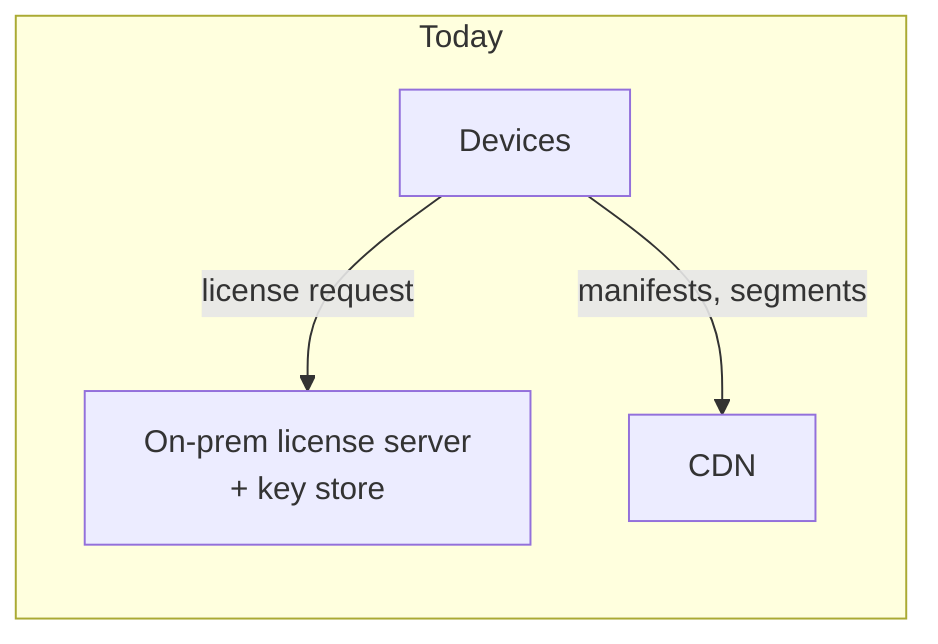
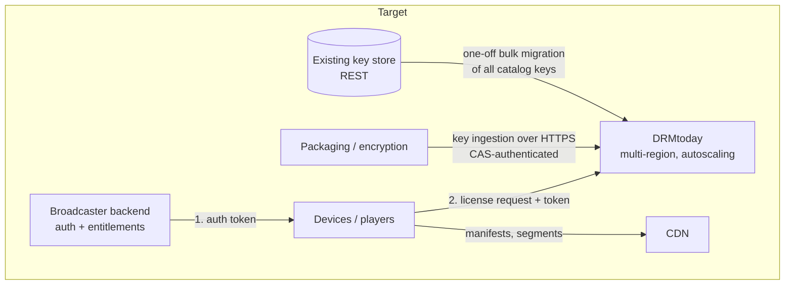

# Solution design: moving a broadcaster's DRM licensing to DRMtoday

Prepared for the solution-design part of the challenge. It is written as the
material I would bring to the customer meeting: situation, root cause, target
architecture, advantages, migration plan with a rough timeline, risks and the
questions I still need answered.

## 1. Customer situation

* Broadcaster that recently launched a VoD service on OTT.
* DRM licensing runs on **one on-premise server** that stores all content keys
  and delivers Widevine/PlayReady/FairPlay licenses to devices.
* Content keys are available through a simple REST request on that server.
* **Symptom**: when a new, popular asset is published, end users get
  *"DRM license request timeout"* errors.
* A migration to a new server infrastructure is already planned.
  **Service continuity is the top constraint.**

## 2. Why the timeouts happen

A premiere is a synchronized event: a large share of the audience presses play
within the same few minutes. Every playback start needs at least one license
request, and often several (one per DRM system in the fleet, separate audio and
video keys, renewals). Unlike manifests and media segments, **licenses cannot
be cached by the CDN**: each one is bound to a device and a session. So on
release night the whole audience lands, uncached, on the one component that
does not scale elastically.

On that server each license costs a synchronous key lookup (the REST call to
the key store) plus the DRM-specific cryptography. With a fixed capacity,
requests queue, latency climbs past the player's license timeout (typically
5–10 s), players retry, and the retry storm finishes the job. The error the
user sees is a timeout, but the cause is a capacity cliff on a single,
non-elastic license server.

What I would confirm with the customer's data before the meeting: license
server request rate and p99 latency around the last premieres, error codes by
device type from player analytics, and key-lookup latency under load.

## 3. Target architecture with DRMtoday

Building blocks:

1. **Keys stay the same.** DRMtoday accepts customer-provided keys at
    ingestion, so the existing CENC-encrypted catalog is **not re-encrypted or
    re-packaged**. Migration is a copy of key material plus a change of license
    URL in the players.
2. **Key ingestion** over HTTPS with the CAS-authenticated protocol:
    * a one-off migration job reads every key from the current REST key store
      and ingests it (asset ID, key ID, key, variant/track, policy);
    * the packaging workflow ingests the keys of every new title at encryption
      time (REST ingest, or CPIX/SPEKE if the packager speaks it). During the
      transition keys are written to both systems.
3. **License delivery** from DRMtoday's multi-region AWS infrastructure, which
    auto-scales and fails over between regions. Widevine, PlayReady and
    FairPlay are served through one integration.
4. **Authorization**: the broadcaster already knows who the user is and what
    they are entitled to. Two DRMtoday models fit:
    * **Token authorization (recommended).** The backend issues a short-lived,
      signed DRMtoday authorization token to the player after its own
      entitlement check; the player sends it with the license request;
      DRMtoday validates it and delivers the license. At license time nothing
      synchronous depends on the broadcaster's systems, so the premiere peak
      lands only on DRMtoday. The token is generated as part of the existing
      "play" API call, which the backend already handles at that scale.
    * **Callback authorization.** DRMtoday calls the broadcaster's
      authorization API for each license. Fewer client changes, but it puts
      the premiere peak on the customer's entitlement API, which is the kind of
      bottleneck we are removing. Acceptable only if that API is elastic.
5. **Players** switch the license URL and attach the token. The change is
    delivered behind remote configuration (feature flag) so traffic can be
    moved gradually per platform and reverted instantly.
6. **Observability**: DRMtoday dashboard and delivery logs (per request:
    device type, DRM system, result), reporting API, optional log push to the
    customer's S3 bucket, combined with the customer's player analytics.

## 4. Why DRMtoday, for this customer

* **Elastic capacity**: from hundreds to 100,000+ license requests per second,
  no capacity planning for premieres. This is the direct fix for the incident.
* **Availability**: multi-region deployment with automatic failover to the
  next-closest region, SLA options up to 99.999%. A single on-prem site cannot
  offer this at any price.
* **Latency**: licenses served from the region nearest to the viewer, so
  stream start-up is faster, not just more reliable.
* **No re-packaging**: customer-provided keys are accepted, which turns a
  risky content migration into a key copy and a URL switch.
* **Multi-DRM through one API**, with studio compliance handled (Farncombe
  Security Audit, hardware-security detection and filtering, HDCP
  enforcement, security templates matching common studio requirements).
  Relevant for the premium content that causes the peaks in the first place.
* **Access control the broadcaster can monetize**: concurrent-stream limits,
  device filtering, geoblocking, quality tiers by device security level,
  persistent/offline licenses, license pre-fetching.
* **Lower total cost**: no DRM servers to patch, scale, audit or staff 24/7;
  Castlabs support and documentation instead.
* **Future proof**: live and key rotation if they add linear channels; a
  self-hosted option exists if regulation ever requires it.

## 5. Migration plan

Principles: keep both license systems live until the new one has proven itself
on a real premiere; move traffic gradually; make rollback a configuration
flip; never re-encrypt content; verify every step with data.

| phase | weeks | work | exit criterion |
|------|-------|------|----------------|
| **0. Discovery and setup** | 1 | Collect inputs (section 7). Create DRMtoday staging and production merchant accounts, DRM policies/security templates, asset-ID mapping agreed. Share the integration docs with the customer's teams. | Signed-off target design and ID mapping. |
| **1. Integration build** | 2–4 | (a) Key migration tool: reads the REST key store, ingests into DRMtoday via CAS-authenticated HTTPS in idempotent batches, produces a reconciliation report. (b) Dual-write of new titles' keys from the packaging workflow. (c) Token service in the backend (or callback endpoint). (d) Player changes per platform behind a remote-config flag, legacy URL kept as fallback. (e) Tests against DRMtoday staging on the device matrix. | Playback with DRMtoday licenses on every supported platform in staging. |
| **2. Catalog migration and verification** | 4–6 | Bulk ingest the whole catalog. Reconcile key counts and key IDs. Automated playback checks on a statistical sample per DRM system and device class. Load test with synthetic license traffic above the worst premiere seen. Production traffic still on-prem. | 100% of keys reconciled; load test passed; runbook and rollback rehearsed. |
| **3. Pilot** | 6–8 | Internal users, then 5%, 25%, 50% of production traffic (by platform or user cohort). Compare license success rate, p99 latency, start-up time and support tickets against the on-prem baseline. Include at least one premiere at ≥ 25%. | Error and latency targets met on a real premiere; no rollback needed. |
| **4. Full cutover** | 8–10 | 100% of license traffic on DRMtoday. On-prem kept warm as fallback, dual-write continues. | Two weeks at 100% with stable metrics. |
| **5. Decommission** | 10–12 | Stop dual-write, DRMtoday becomes the single source of keys (customer keeps an escrow copy per its policy). Shut down the on-prem server. Hand over dashboards, alerts and runbooks. Review. | On-prem switched off; operations handed over. |

**About 10–12 weeks end to end.** The DRMtoday side (accounts, policies,
ingestion) takes days; the calendar is set by the customer's player release
cycles (app-store review, smart-TV certification) and by scheduling the pilot
around real premieres. Phases 1 and 2 overlap.

Quick wins while the migration runs, to soften the next premieres on the
current server: exponential backoff with jitter on license retries in the
players, staggered autoplay, a key-lookup cache in front of the REST key
store, pre-fetching the license for the "next up" item, and planning
capacity (or a temporary scale-out of the on-prem server) for known release
windows.

## 6. Risks and mitigations

| risk | mitigation |
|------|------------|
| Asset/key ID mapping errors produce unplayable titles | Reconciliation report plus automated playback checks before any production traffic; migrate per catalog slice. |
| Legacy devices with a hard-coded license URL or no remote config | Roll out per platform; keep the legacy URL alive until those platforms are migrated or retired. |
| Authorization token mistakes lock users out | Start with an internal cohort; DRMtoday delivery logs show the rejection reason per request. |
| Callback mode would move the bottleneck to the entitlement API | Prefer token authorization; if callback is required, scale and cache that API first and load-test it. |
| Key material exposure during migration | HTTPS plus CAS authentication, migration tool run from a hardened host, no keys in logs, temporary data wiped, access reviewed. |
| Premiere during a migration step | Freeze phase changes around major releases; every step is reversible by flag. |
| Studio approval of the new setup | DRMtoday's security templates match common studio requirements; involve content-owner security reviews early. |

## 7. Questions for the customer

* Which DRM systems and player stacks are in production (web, Android, iOS,
  smart TV, set-top boxes)? Any devices without remote configuration?
* Catalog size: number of assets and keys, key per asset or per track/quality,
  any key rotation or live channels planned?
* How is the license URL delivered today: app config, manifest
  (`ContentProtection`/`EXT-X-KEY`), or both?
* How do users authenticate and how are entitlements checked at play time?
  Peak "play" requests per second?
* Peak license requests per second and latency during the last premieres;
  which error codes do the players report?
* Offline/download, persistent licenses, concurrent-stream rules, HD/UHD
  policies required by content owners?
* Regions served, data-residency or regulatory constraints, SLA expectations.
* Timeline of the planned infrastructure migration and upcoming premieres
  (change windows).

## 8. Meeting outline (10 minutes)

1. What happened and why: a non-elastic license server on a synchronized
   peak (2 min).
2. Target architecture: keys to DRMtoday, token authorization, players switch
   URL (3 min).
3. Why DRMtoday fits: elasticity, multi-region availability, no re-packaging,
   compliance, access control (2 min).
4. Migration plan: dual-run, gradual shift, rollback by flag, 10–12 weeks
   (2 min).
5. Open questions and next steps: discovery workshop, staging account (1 min).
